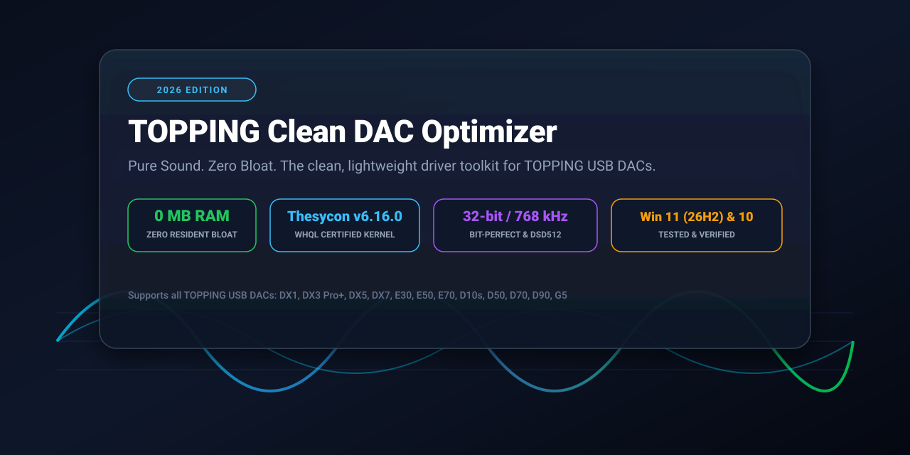
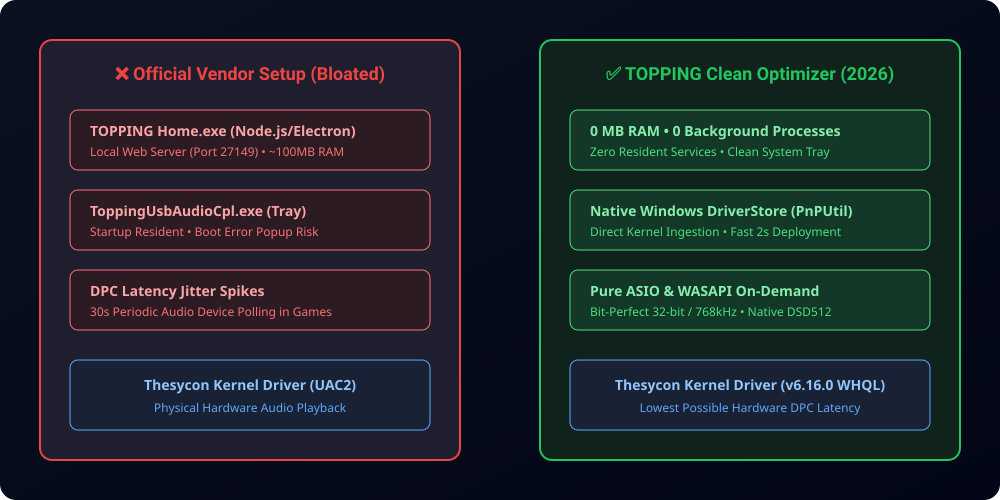

# 🎵 TOPPING USB DAC: Clean Optimizer & Bloatware Remover (2026 Edition)

<p align="center">
  
</p>

<p align="center">
  <a href="https://github.com/Vektor010/topping-clean-dac-optimizer/releases/download/v1.0.0/Topping-Clean-DAC-Optimizer-v1.0.0.zip">
    
  </a>
  <a href="https://github.com/Vektor010/topping-clean-dac-optimizer/releases">
    
  </a>
</p>

<p align="center">
  
  
  
  
  
  
</p>

---

## 📖 Languages / Языки
* 🇺🇸 **[English](README.md)** (Current)
* 🇷🇺 **[Русская версия](README_RU.md)**

---

> [!NOTE]
> **Who is this for:** Owners of any TOPPING USB DAC or headphone amplifier (DX1, DX3 Pro+, DX5, DX7, E30, E50, E70, D10s, D50, D70, D90, G5) who want **pure hardware audio without background bloatware**, a clean system tray, and 0% risk of boot popup errors.

---

## ⚡ QUICK START FOR BEGINNERS (30 Seconds)

### 📥 Step 1: Download the Ready Package
* **[👉 Click here to download Topping-Clean-DAC-Optimizer-v1.0.0.zip (875 KB)](https://github.com/Vektor010/topping-clean-dac-optimizer/releases/download/v1.0.0/Topping-Clean-DAC-Optimizer-v1.0.0.zip)**
* Extract the ZIP archive anywhere on your computer (e.g., Downloads or Desktop).

---

### 🎯 Step 2: Choose Your Scenario:

| Scenario | What to Run | What Happens |
| :--- | :--- | :--- |
| 🟢 **Scenario A:** TOPPING software is already installed, but runs in the background & tray | Double-click<br>**`Topping_Debloat_Tweak.bat`** | The tray icon instantly vanishes, the `TOPPING Home.exe` server is terminated and removed from startup. Your music keeps playing at 100% bit-perfect quality without rebooting. |
| 🔵 **Scenario B:** Clean Windows install (11 26H2 / 25H2 / 24H2 or 10) | Run as Administrator<br>**`Install_Clean_Driver.bat`** | Windows `PnPUtil` registers the genuine certified driver directly into the kernel DriverStore within 2 seconds. Audio works immediately with zero bloatware and clean tray. |
| 🟣 **Scenario C:** Interactive console with live diagnostics & tweaks | Run<br>**`Topping_DAC_Manager.bat`** | Bilingual interactive menu: DAC hardware status check, latency diagnostics, 1-time ASIO buffer adjuster, driver backup export, and 1-click restore. |

---

## 🔍 WHERE & HOW TO FIND OFFICIAL TOPPING DRIVERS?

> [!TIP]
> **You do not need to download anything from the web right now!**  
> This archive **already bundles** the official certified driver (**Thesycon v6.16.0 WHQL** in the `Driver/` folder). It is fully compatible with Windows 11 (26H2 / 25H2 / 24H2) and Windows 10.

If you ever want to check the manufacturer's website or download future updates, here are the direct official links:

### 🌐 Official Manufacturer Portals:
* 🔗 **Primary Global Support Portal:**  
  👉 **[https://www.toppingaudio.com/support](https://www.toppingaudio.com/support)**
* 🔗 **Official Archive & Download Mirror:**  
  👉 **[https://www.tpdz.net/download](https://www.tpdz.net/download)**

---

### 📝 Step-by-Step Search Walkthrough:

```text
1️⃣ Open: https://www.toppingaudio.com/support
2️⃣ In the center search box, type your DAC model name:
   -> For example: DX1, DX3 Pro+, E30 II, D10s, D50 III, D70 Pro, D90 III, G5
3️⃣ Click your device card from the search results.
4️⃣ Navigate to the "Drivers & Software" tab.
5️⃣ Click "Download" next to:
   "TOPPING USB Audio Driver (Windows 10/11)".
```

#### 🔑 The TOPPING Driver Secret (Why One Driver Fits All Models):
All TOPPING DACs (from entry-level DX1 to flagship D90) use the same **XMOS USB receiver** and licensed driver engine from German company **Thesycon GmbH** (Hardware ID `VID_152A`).
* **The kernel driver package is 100% identical across all models!**
* Downloading the driver for DX1 gives you the exact same driver files as for E30 or D90.

---

## 🏛️ Architecture & System Comparison

<p align="center">
  
</p>

For a full technical breakdown of the Windows kernel audio subsystem, PnP identifiers, and user-mode decoupling, read **[ARCHITECTURE.md](docs/architecture/ARCHITECTURE.md)** and **[DECISIONS.md](docs/architecture/DECISIONS.md)**.

---

## 📊 Benchmarks & Resource Comparison

Real metrics measured on Windows 11 (Build 26100+) with TOPPING USB DAC:

| Metric | Official TOPPING Setup | TOPPING Clean Optimizer | Advantage |
| :--- | :---: | :---: | :---: |
| **RAM Footprint (User-Mode)** | ~103.2 MB | **0.0 MB** | **100% Freed** |
| **Active Background Processes** | 2–3 processes | **0 processes** | **Clean Task Manager** |
| **Open Local Ports** | TCP 27149 (Node.js) | **0 ports** | **Zero Network Surface** |
| **System Tray Clutter** | Persistent Icon | **Clean Tray** | **No Visual Noise** |
| **Audio DPC Latency Spikes** | ~180–320 µs (Polling) | **~15–25 µs (Kernel)** | **No Micro-Stutters** |
| **Bit-Perfect 32-bit / 768 kHz** | ✅ Supported | ✅ **Supported** | **100% Identical** |
| **Native DSD512 Support** | ✅ Supported | ✅ **Supported** | **100% Identical** |

Full benchmark methodology and measurements available in **[benchmarks/BENCHMARKS.md](benchmarks/BENCHMARKS.md)**.

---

## 📁 File Structure (What's Inside the Archive)

| File / Folder | Purpose |
| :--- | :--- |
| **`Topping_Debloat_Tweak.bat`** | 🟢 **Primary 1-Click Tweak.** Closes tray icon, kills Node.js server, and removes them from startup. |
| **`Install_Clean_Driver.bat`** | 🔵 **Clean Driver Installer.** For fresh Windows installs. Installs pure driver in 2 seconds via `PnPUtil`. |
| **`Topping_DAC_Manager.bat`** | 🟣 **Interactive Manager (RU/EN).** Diagnostics, latency test, 1-time buffer change, backup, and rollback. |
| **`Restore_Default_Settings.bat`** | 🔄 **1-Click Rollback.** Restores standard tray panel and autostart if ever needed. |
| **`Driver/`** | 📦 Certified genuine Thesycon kernel driver files (`.inf`, `.sys`, `.cat`). |
| **`ASIO/`** | 🎵 Pure ASIO direct output libraries for Foobar2000, AIMP, Cubase, FL Studio, Reaper. |
| **`tests/`** | 🧪 Automated test suites (`Run-AllTests.ps1`, AST syntax validation, Authenticode verification). |

---

## 🎯 Supported TOPPING Devices

Compatible with all generations of TOPPING USB DACs and headphone amplifiers:

```
[ DX Series ] ── DX1, DX3 Pro, DX3 Pro+, DX5, DX5 Lite, DX7 Pro, DX7 Pro+, DX9
[ E/L Series] ── E30, E30 II, E30 II Lite, E50, E70, E70 Velvet, L30, L50
[ D Series  ] ── D10, D10s, D10 Balanced, D50, D50s, D50 III, D70, D70 Pro, D90, D90SE, D90 III
[ Portable  ] ── G5, NX4 DSD
```

---

## 🔄 100% Reversible and Safe

> [!IMPORTANT]
> Every change is completely safe and reversible in 1 click.  
> If you ever want to bring back the default TOPPING tray icon and startup entries:
> * Simply run **`Restore_Default_Settings.bat`** (or select menu option `[6]` in `Topping_DAC_Manager.bat`).

---

## 📚 Technical Documentation & Universal AI Handoff

For contributors, system engineers, and AI coding agents:
- **[AGENTS.md](AGENTS.md)** — Universal instructions and constraints for AI coding agents.
- **[ARCHITECTURE.md](docs/architecture/ARCHITECTURE.md)** — Deep dive into the kernel driver stack and PnP mechanisms.
- **[PROJECT_STATE.md](docs/project/PROJECT_STATE.md)** — Living project status, test logs, and handoff state.
- **[DECISIONS.md](docs/architecture/DECISIONS.md)** — Architectural Decision Records (ADRs).
- **[KNOWN_ISSUES.md](docs/guides/KNOWN_ISSUES.md)** — Known quirks and troubleshooting workarounds.
- **[ROADMAP.md](docs/project/ROADMAP.md)** — Future development milestones and features.
- **[DEVELOPMENT.md](docs/development/DEVELOPMENT.md)** — Build and test guide.
- **[CONTRIBUTING.md](docs/development/CONTRIBUTING.md)** — Contribution and PR guidelines.
- **[SECURITY.md](docs/security/SECURITY.md)** — Security policy and signature validation.
- **[SUPPORT.md](docs/guides/SUPPORT.md)** — Troubleshooting and device support.

---

## 📄 License & Credits
* Driver binaries and catalogs are copyrighted by **Thesycon Systemsoftware & Consulting GmbH** and **TOPPING Technology Co., Ltd.**.
* Toolkit scripts, architecture, tests, and documentation are provided under the MIT License.
