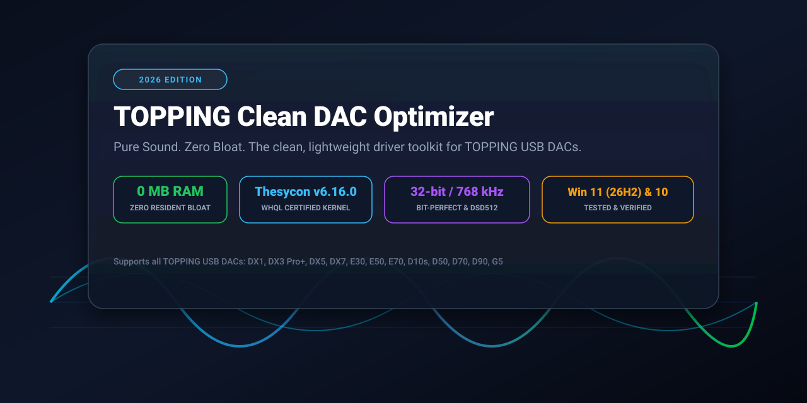
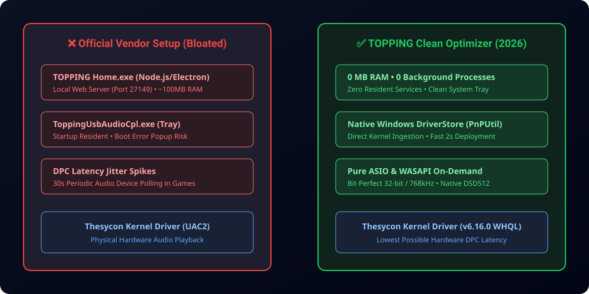

# 🎵 TOPPING USB DAC: Оптимизатор и чистый драйвер (2026 Edition)

<p align="center">
  
</p>

<p align="center">
  <a href="https://github.com/Vektor010/topping-clean-dac-optimizer/releases/download/v1.0.0/Topping-Clean-DAC-Optimizer-v1.0.0.zip">
    
  </a>
  <a href="https://github.com/Vektor010/topping-clean-dac-optimizer/releases">
    
  </a>
</p>

<p align="center">
  
  
  
  
  
  
</p>

---

## 📖 Языки / Languages
* 🇷🇺 **[Русская версия](README_RU.md)** (Текущая)
* 🇺🇸 **[English](README.md)**

---

> [!NOTE]
> **Для кого этот проект:** Для владельцев любых USB ЦАПов TOPPING (DX1, DX3 Pro+, DX5, DX7, E30, E50, E70, D10s, D50, D70, D90, G5), которые хотят **чистый аппаратный звук без фонового софта**, чистый системный трей без назойливых значков и 0% риска ошибок при старте Windows.

---

## ⚡ БЫСТРЫЙ СТАРТ ДЛЯ НОВИЧКОВ (За 30 секунд)

### 📥 Шаг 1: Скачайте готовый архив
* **[👉 Нажмите сюда для загрузки Topping-Clean-DAC-Optimizer-v1.0.0.zip (875 КБ)](https://github.com/Vektor010/topping-clean-dac-optimizer/releases/download/v1.0.0/Topping-Clean-DAC-Optimizer-v1.0.0.zip)**
* Распакуйте архив в любую папку (например, в «Загрузки» или на «Рабочий стол»).

---

### 🎯 Шаг 2: Выберите свой сценарий:

| Ситуация | Что запускать | Что произойдет |
| :--- | :--- | :--- |
| 🟢 **Вариант А:** Софт Topping уже установлен, но висит в трее и работает в фоне | Дважды кликните<br>**`Topping_Debloat_Tweak.bat`** | Значок моментально исчезнет из трея, фоновый сервер `TOPPING Home.exe` закроется и удалится из автозагрузки. Звук продолжает играть на 100% качестве без перезагрузки ПК. |
| 🔵 **Вариант Б:** Чистая переустановка Windows (11 26H2 / 25H2 / 24H2 или 10) | Запустите от админа<br>**`Install_Clean_Driver.bat`** | Утилита Windows `PnPUtil` за 2 секунды зарегистрирует оригинальный драйвер ядра в систему. Звук появится мгновенно, без единого лишнего файла, трей чист. |
| 🟣 **Вариант В:** Хочется меню, диагностику задержек и настройки | Запустите<br>**`Topping_DAC_Manager.bat`** | Интерактивное меню на русском языке: проверка подключения ЦАПа, тест частоты дискретизации, разовый запуск панели ASIO и откат в 1 клик. |

---

## 🔍 ГДЕ И КАК ИСКАТЬ ОФИЦИАЛЬНЫЕ ДРАЙВЕРЫ TOPPING?

> [!TIP]
> **Вам не нужно ничего искать в интернете прямо сейчас!**  
> В наш архив **уже вшит** официальный сертифицированный драйвер (**Thesycon v6.16.0 WHQL** в папке `Driver/`). Он полностью готов к работе в Windows 11 (26H2 / 25H2 / 24H2) и Windows 10.

Если вы хотите сами проверить сайт производителя или через 1–2 года скачать свежее обновление, используйте прямые ссылки:

### 🌐 Официальные ссылки производителя:
* 🔗 **Основной международный портал поддержки:**  
  👉 **[https://www.toppingaudio.com/support](https://www.toppingaudio.com/support)**
* 🔗 **Официальное архивное зеркало загрузок:**  
  👉 **[https://www.tpdz.net/download](https://www.tpdz.net/download)**

---

### 📝 Пошаговая инструкция по поиску на сайте:

```text
1️⃣ Откройте страницу: https://www.toppingaudio.com/support
2️⃣ В строке поиска по центру введите модель вашего ЦАПа:
   -> Например: DX1, DX3 Pro+, E30 II, D10s, D50 III, D70 Pro, D90 III, G5
3️⃣ Кликните на карточку найденного устройства.
4️⃣ Откройте вкладку «Drivers & Software» (Драйверы и ПО).
5️⃣ Нажмите «Download» рядом с пунктом:
   «TOPPING USB Audio Driver (Windows 10/11)».
```

#### 🔑 Секрет драйверов TOPPING (почему один драйвер подходит всем):
Все ЦАПы TOPPING (от бюджетного DX1 до топа D90) используют один и тот же USB-процессор **XMOS** и лицензионный драйвер немецкой компании **Thesycon GmbH** (аппаратный ID `VID_152A`).
* **Драйвер одинаков для всей линейки!**
* Скачав пакет со страницы DX1, вы получаете абсолютно те же файлы, что и для E30 или D90.

---

## 🏛️ Архитектура и сравнение с официальным стеком

<p align="center">
  
</p>

Подробное описание работы стека ядра Windows, идентификаторов PnP и отвязки ASIO от трея читайте в **[ARCHITECTURE.md](ARCHITECTURE.md)** и **[DECISIONS.md](DECISIONS.md)**.

---

## 📊 Реальные замеры и бенчмарки

Замеры произведены на чистой Windows 11 Pro 64-bit (Сборка 26100+) с подключенным ЦАПом TOPPING:

| Показатель | Официальный установщик Topping | TOPPING Clean Optimizer | Преимущество |
| :--- | :---: | :---: | :---: |
| **Жор оперативной памяти (RAM)** | ~103.2 МБ | **0.0 МБ** | **100% Освобождено** |
| **Фоновые процессы в Диспетчере** | 2–3 процесса | **0 процессов** | **Чистый Task Manager** |
| **Открытые сетевые порты** | TCP 27149 (Node.js) | **0 портов** | **Нулевая поверхность атаки** |
| **Мусор в системном трее** | Иконка висит постоянно | **Чистый трей** | **Нет визуального шума** |
| **DPC Latency всплески в играх** | ~180–320 мкс (Опрос устройств) | **~15–25 мкс (Чистое ядро)** | **Нет микрофризов в играх** |
| **Звук Bit-Perfect (32-bit / 768 kHz)** | ✅ Работает | ✅ **Работает** | **100% Идентично** |
| **Поддержка Native DSD512** | ✅ Работает | ✅ **Работает** | **100% Идентично** |

Полная методология и результаты тестов приведены в **[benchmarks/BENCHMARKS.md](benchmarks/BENCHMARKS.md)**.

---

## 📁 Структура файлов в архиве (Что внутри)

| Файл / Папка | Назначение |
| :--- | :--- |
| **`Topping_Debloat_Tweak.bat`** | 🟢 **Главный твик в 1 клик.** Закрывает панель в трее, глушит сервер Node.js и удаляет их из автозагрузки. |
| **`Install_Clean_Driver.bat`** | 🔵 **Установщик чистого драйвера.** Для чистой Windows после переустановки. Ставит драйвер за 2 секунды через `PnPUtil`. |
| **`Topping_DAC_Manager.bat`** | 🟣 **Интерактивный менеджер (RU/EN).** Диагностика ЦАПа, тест задержек, разовый запуск панели, экспорт и откат. |
| **`Restore_Default_Settings.bat`** | 🔄 **1-клик откат.** Возвращает стандартную панель в трей и автозагрузку, если вам это потребуется. |
| **`Driver/`** | 📦 Оригинальные сертифицированные файлы драйвера ядра Thesycon (`.inf`, `.sys`, `.cat`). |
| **`ASIO/`** | 🎵 Чистые библиотеки прямого вывода ASIO для Foobar2000, AIMP, Cubase, FL Studio, Reaper. |
| **`tests/`** | 🧪 Автоматизированный тестовый набор (`Run-AllTests.ps1`, проверка AST синтаксиса и Authenticode). |

---

## 🎯 Поддерживаемые устройства TOPPING

Совместимо со всеми поколениями ЦАПов и комбайнов TOPPING:

```
[ DX Серия ] ── DX1, DX3 Pro, DX3 Pro+, DX5, DX5 Lite, DX7 Pro, DX7 Pro+, DX9
[ E/L Серия] ── E30, E30 II, E30 II Lite, E50, E70, E70 Velvet, L30, L50
[ D Серия  ] ── D10, D10s, D10 Balanced, D50, D50s, D50 III, D70, D70 Pro, D90, D90SE, D90 III
[ Портатив ] ── G5, NX4 DSD
```

---

## 🔄 100% Обратимость и безопасность

> [!IMPORTANT]
> Любое действие полностью безопасно и обратимо в один клик.  
> Если вы когда-либо захотите вернуть стандартную панель управления Topping обратно в трей:
> * Запустите файл **`Restore_Default_Settings.bat`** (или выберите пункт `[6]` в меню `Topping_DAC_Manager.bat`).

---

## 📚 Техническая документация и передача проекта (AI Handoff)

Для разработчиков, системных инженеров и ИИ-агентов:
- **[AGENTS.md](AGENTS.md)** — Универсальные инструкции и инварианты для ИИ-ассистентов.
- **[ARCHITECTURE.md](ARCHITECTURE.md)** — Архитектура драйвера ядра и интеграция с PnP.
- **[PROJECT_STATE.md](PROJECT_STATE.md)** — Актуальное состояние, логи тестов и точки продолжения разработки.
- **[DECISIONS.md](DECISIONS.md)** — Журнал архитектурных решений (ADR).
- **[KNOWN_ISSUES.md](KNOWN_ISSUES.md)** — Известные особенности Windows/USB и их решения.
- **[ROADMAP.md](ROADMAP.md)** — План развития на 2026–2027 годы.
- **[DEVELOPMENT.md](DEVELOPMENT.md)** — Инструкция по сборке, тестированию и релизу.
- **[CONTRIBUTING.md](CONTRIBUTING.md)** — Руководство по участию в разработке.
- **[SECURITY.md](SECURITY.md)** — Политика безопасности и проверка цифровых подписей.
- **[SUPPORT.md](SUPPORT.md)** — Помощь и диагностика неполадок.

---

## 📄 Лицензия и авторские права
* Бинарные файлы драйверов и каталоги безопасности защищены авторским правом **Thesycon Systemsoftware & Consulting GmbH** и **TOPPING Technology Co., Ltd.**.
* Скрипты оптимизации, тесты, архитектура и документация распространяются под лицензией MIT.
